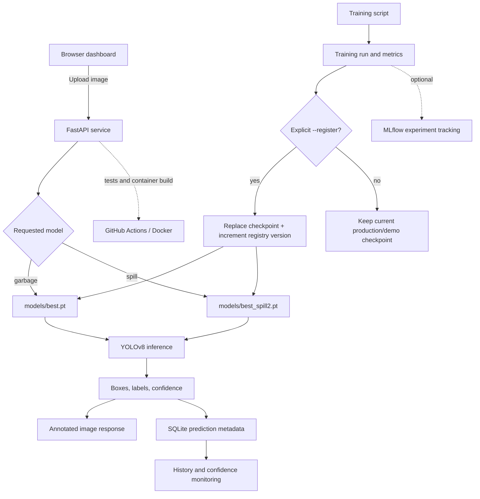

# Architecture and request lifecycle

## Boundaries

- The browser handles image selection and visualizes API responses.
- FastAPI validates the upload, loads the selected YOLO model lazily, runs prediction, and returns boxes plus an annotated JPEG.
- SQLite stores metadata only, not uploaded source images.
- Model registry JSON is a lightweight project-level registry; it is not a managed enterprise model registry.
- Monitoring in this version is an operational baseline (counts, response latency, confidence distribution), not a certified drift detector.
